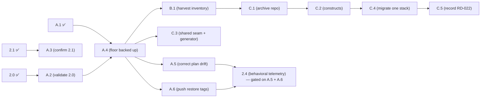
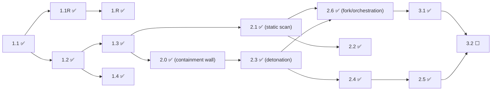

# Build Order - a dependency-graph view of what can be built when

> **This is a derived view, not the source of truth.** The one and only source of
> truth for story status is [`../RUNBOOK.md`](../RUNBOOK.md), now organized as a
> dependency-driven tiered build order. This page shows the **dependency structure**
> (the graph and the buildable-now / blocked-by relationships) drawn **from** that
> ledger to make the shape of the work easy to see. It does **not** own or maintain
> a copy of any story's status: for status, always read the RUNBOOK. This page must
> be **regenerated whenever dependencies change**, and it **never changes any
> status** on its own. If this page and the RUNBOOK ever disagree, the RUNBOOK wins.
>
> This page **supersedes** any earlier flat, linear "execution order" list. Story
> numbers (2.0, 2.1, 2.2, ...) are **not** a build order. The real order comes from
> the dependency graph below.
>
> How to read it, for a non-technical reader: a piece of work can only be built once
> **every** piece it depends on is finished (marked ✅). See
> [`governance/OPERATING_MODEL.md`](governance/OPERATING_MODEL.md) for how we then
> choose one at a time and prove it live.

## Status legend (for reference; status lives in the RUNBOOK)

`⬜ Not Started` · `🟡 In Progress` · `⛔ Blocked` · `✅ Done (validated)`

These markers are the legend the RUNBOOK uses. This page does not maintain a
per-story status list; any status glyph you see in the diagrams below is
**illustrative only**. For the authoritative status of any story, read the tiered
build order in [`../RUNBOOK.md`](../RUNBOOK.md).

## The dependency graph (Phase 1 and Phase 2 pipeline)

This is the true shape of the numbered pipeline. Note especially that **2.0 and 2.1
are independent siblings** of 1.3 (neither depends on the other), and that **2.0's
real downstream is 2.3**, not 2.1. The Floor & Harvest (A/B/C) track cross-links into
this same graph and is shown in its own section below; the governance (`G`) stories
have no pipeline dependency. **Every** story — pipeline, governance, and Floor &
Harvest — is interleaved into one build-tier order in the RUNBOOK master table (see
[`../RUNBOOK.md`](../RUNBOOK.md)), computed exactly as
[`../METHODOLOGY.md`](../METHODOLOGY.md) §1a defines (tier = 1 + the highest tier of
any dependency). The glyphs in the diagrams are illustrative snapshots; status is
owned solely by the RUNBOOK.

```
Phase 1 (all ✅)
  1.1 ✅ ── 1.1R ✅ ── 1.R ✅
   └── 1.2 ✅ ─┬── 1.3 ✅
               └── 1.4 ✅

1.3 ✅ forks into two independent branches:

   branch A (the detonation line):
     2.0 ✅ ── 2.3 ✅ ── 2.4 ✅ ── 2.5 ✅
     (containment    (detonation  (telemetry (sanitize
      wall)           chamber)     capture)   telemetry)
     NOTE: 2.4 ALSO has a cross-track hard dependency on A.5 + A.6 (the
     "clean the ground first" gate, 2026-09-07) — see the Floor & Harvest
     section below. 2.4 is buildable only when 2.3 AND A.5 AND A.6 are ✅.

   branch B (the static line):
     2.1 ✅ ── 2.2 ✅
     (static scan)   (compliance mapping)

   2.6 ✅ joins BOTH branches (needs 2.1 AND 2.3):
     2.1 ✅ ──┐
              ├── 2.6 ✅  (parallel orchestration / fork)
     2.3 ✅ ──┘

Phase 3 hangs off 2.6 and 2.5:
     2.6 ✅ ── 3.1 ✅ ── 3.2 ⬜ (also needs 2.5) ── 3.3 ── 3.4 ── 3.5
     2.5 ✅ ───────────────┘
```

## The Floor & Harvest (A/B/C) track — same graph, cross-linked to the pipeline

The Floor & Harvest transition track (the move to a reusable component archive) is
**not** a separate island: it hangs off the pipeline dependency graph and is
interleaved into the very same build tiers in [`../RUNBOOK.md`](../RUNBOOK.md). Its
narrative lives in
[`governance/FLOOR_AND_HARVEST_PLAN.md`](governance/FLOOR_AND_HARVEST_PLAN.md); its
**status and tiers are owned by the RUNBOOK** like every other story.

```
A.1 (tier 0, no deps) ─┐
                       ├── A.4 ── B.1 ──┬── C.1 ── C.2 ── C.4 ── C.5
2.0 ✅ ── A.2 ─────────┘         │      │
2.1 ✅ ── A.3                    └── C.3 (needs A.4 only)

Cross-links into the pipeline graph:
  A.2 needs 2.0 (the validated containment wall) ── A.2 IS "validate 2.0 live"
  A.3 needs 2.1 (confirm the static line into the floor)
  A.4 needs A.1 + A.2   → the backed-up Phase-2 floor
  B.1 needs A.4         → harvest inventory (survey → archive build spec)
  C.1 needs B.1         → stand up the infra-building-blocks archive repo
  C.2 needs C.1         → build the parameterized constructs
  C.3 needs A.4         → shared Python seam + one generator (parallel to C.1/C.2)
  C.4 needs C.2         → migrate ONE stack onto the archive (drift-proven)
  C.5 needs C.4         → record the practice (RD-022 into PROJECT_PLAN, etc.)
```

The same cross-track shape as a mermaid diagram:



**A.5 / A.6 gate 2.4.** Two tier-6 F&H stories, `A.5` (correct the Floor & Harvest
plan drift) and `A.6` (push the outstanding `restore/phase-2-floor-green` +
`restore/story-2.3-green` tags), are **hard dependencies of the pipeline story
`2.4`** (2026-09-07 decision). This is the structural form of "finish and back up the
floor before building on it": 2.4 cannot start until both are ✅. It lifts 2.4 to tier
7 and cascades the rest of the detonation→telemetry→Phase-3→Phase-4 chain (see the
RUNBOOK master-table dependency note for the full re-tiering).

The same shape as a mermaid diagram:



Reading the two branches: the **detonation line**
(`2.0 → 2.3 → 2.4 → 2.5`) is where the dangerous work happens, because 2.3 onward
actually runs untrusted code inside the containment that 2.0 builds. The **static
line** (`2.1 → 2.2`) only inspects artifacts and never runs them. The two lines are
"parallel" only in the sense that the graph does not force an order between them;
with a single developer we still do one at a time (see the note on "parallel" in
[`governance/OPERATING_MODEL.md`](governance/OPERATING_MODEL.md) §4).

## Buildable-now vs blocked-by (every story)

The direct dependencies below describe the graph's **structure**; they do not
change. **Status is not restated here** (that would be a second copy that could
drift): status lives only in the tiered build order in
[`../RUNBOOK.md`](../RUNBOOK.md). Read "Buildable when" as the rule for when a story
becomes eligible: a story is buildable once **all** of its direct dependencies are
done (✅) in the RUNBOOK. "On the critical path to detonation" flags the chain
leading to the dangerous Phase-2 detonation work (2.3 onward). For every story's
current status: **see RUNBOOK**.

| Story | Title | Direct dependencies | Buildable when | On critical path to detonation? |
|-------|-------|---------------------|----------------|---------------------------------|
| 1.1 | Intake gateway endpoint | none | foundation (no dependency) | (foundation) |
| 1.1R | Remediation: durable tracking record Forensic → Hub | 1.1 | 1.1 done in RUNBOOK | (foundation) |
| 1.R | Restore-point mechanism | 1.1R | 1.1R done in RUNBOOK | (foundation) |
| 1.2 | Preprocessor classifier | 1.1 | 1.1 done in RUNBOOK | (foundation) |
| 1.3 | Routing table → static & dynamic lanes | 1.2 | 1.2 done in RUNBOOK | (foundation) |
| 1.4 | Safe-reject path for unknown types | 1.2 | 1.2 done in RUNBOOK | no |
| 2.0 | AWS infra foundation (isolated VPC, IAM, launch template, SSM) | 1.3 | 1.3 done in RUNBOOK | **yes: the containment wall the detonation line sits on** |
| 2.1 | Static scanning stack | 1.3 | 1.3 done in RUNBOOK | no (static line) |
| 2.2 | Compliance-framework mapping + signature scans | 2.1 | 2.1 done in RUNBOOK | no (static line) |
| 2.3 | Detonation chamber (ephemeral EC2 + host-native SSM) | 2.0 | 2.0 done in RUNBOOK | **yes** |
| 2.4 | Behavioral telemetry capture | 2.3, A.5, A.6 | 2.3, A.5, and A.6 done in RUNBOOK | **yes** |
| 2.5 | Telemetry sanitization pipeline | 2.4 | 2.4 done in RUNBOOK | **yes** |
| 2.6 | Parallel orchestration / fork of the two lanes | 2.1, 2.3 | 2.1 and 2.3 done in RUNBOOK | joins both lanes |
| 3.1 | Telemetry aggregation / normalization | 2.6 | 2.6 done in RUNBOOK | downstream |
| 3.2 | Nova Pro correlation engine | 3.1, 2.5 | 3.1 and 2.5 done in RUNBOOK | downstream |
| 3.3 | accuracy + gap_analysis synthesis | 3.2 | 3.2 done in RUNBOOK | downstream |
| 3.4 | Unified threat scoring + prioritized remediations | 3.3 | 3.3 done in RUNBOOK | downstream |
| 3.5 | Verdict derivation (PASS / FAIL / INCONCLUSIVE) | 3.4 | 3.4 done in RUNBOOK | downstream |
| 4.1 | Status-retrieval orchestrator | 3.5 | 3.5 done in RUNBOOK | downstream |
| 4.2 | Dashboard JSON payload | 4.1 | 4.1 done in RUNBOOK | downstream |
| 4.3 | Real-time dashboard | 4.2 | 4.2 done in RUNBOOK | downstream |
| 4.4 | Interactive accept/reject control (Hub) | 4.3, 4.7 | 4.3 and 4.7 done in RUNBOOK | downstream |
| 4.5 | Per-execution PDF report (tiered) | 4.1 | 4.1 done in RUNBOOK | downstream |
| 4.6 | ACCEPT → push artifact to Pipeline-Sandbox | 4.1 | 4.1 done in RUNBOOK | downstream |
| 4.7 | REJECT → destroy artifact + chamber / INCONCLUSIVE hold | 4.1 | 4.1 done in RUNBOOK | downstream |
| G-1 | Compliance back-mapping (RD-014) | none | no pipeline dependency | no (governance) |
| G-2 | Management-artifact integrity (RD-015) | none | no pipeline dependency | no (governance) |
| G-3 | Hard-pause enforcement (RD-023) | none | no pipeline dependency | no (governance) |
| A.1 | Re-apply capture-tooling Phase-2 target extension onto `main` | none | foundation (no dependency) | no (Floor & Harvest) |
| A.2 | Validate Story 2.0 live (7 DoD checks) | 2.0 | 2.0 done in RUNBOOK | no (Floor & Harvest) |
| A.3 | Confirm Story 2.1 into the floor | 2.1 | 2.1 done in RUNBOOK | no (Floor & Harvest) |
| A.4 | Institute deployed-state restore points (both accounts) | A.1, A.2 | A.1 and A.2 done in RUNBOOK | no (Floor & Harvest) |
| B.1 | Harvest inventory (survey → archive build spec) | A.4 | A.4 done in RUNBOOK | no (Floor & Harvest) |
| C.1 | Stand up the `infra-building-blocks` archive repo | B.1 | B.1 done in RUNBOOK | no (Floor & Harvest) |
| C.2 | Build the parameterized constructs the inventory selected | C.1 | C.1 done in RUNBOOK | no (Floor & Harvest) |
| C.3 | Shared Python seam + one generator (parallel to C.1/C.2) | A.4 | A.4 done in RUNBOOK | no (Floor & Harvest) |
| C.4 | Migrate ONE ZTIE stack onto the archive (drift-proven) | C.2 | C.2 done in RUNBOOK | no (Floor & Harvest) |
| C.5 | Record the practice (RD-022 into PROJECT_PLAN, etc.) | C.4 | C.4 done in RUNBOOK | no (Floor & Harvest) |

## What this view says right now

> **This section describes the graph SHAPE, not a status copy.** For the live status
> and the exact next action of any story, read [`../RUNBOOK.md`](../RUNBOOK.md) (its
> OPEN "Ready now" schedule, top-down). The phase roll-up below is **generated from**
> the RUNBOOK master table and machine-verified against it by
> [`../scripts/check_docs.py`](../scripts/check_docs.py) (CHECK H) — if a story flips
> in the RUNBOOK, regenerate this block; do NOT hand-edit it. The `✅`/`⬜` glyphs in
> the diagrams above remain **illustrative snapshots** (they are not machine-checked);
> the RUNBOOK is the only authoritative status.

<!-- BEGIN GENERATED: phase-status (source of truth: ../RUNBOOK.md master table; verified by scripts/check_docs.py CHECK H; do NOT hand-edit) -->

| Phase | Status |
|-------|--------|
| P1 | ✅ |
| P2 | ✅ |
| P3 | 🟡 |
| P4 | ⬜ |

<!-- END GENERATED: phase-status -->

- **Graph shape (structure, not status):** the intake→routing chain (1.x) feeds two
  independent Phase-2 branches — the detonation line (2.0 → 2.3 → 2.4 → 2.5) and the
  static line (2.1 → 2.2) — which 2.6 rejoins; Phase 3 hangs off 2.6 and 2.5. **For
  which of these are done vs. next, read the RUNBOOK** (do not infer it from this
  page).
- **The Advancement Gate** blocks new *pipe* feature work only while the RUNBOOK's
  Validation Debt Register is non-empty; whether it is armed right now is stated in the
  RUNBOOK, not duplicated here. Operational Debt (OD-nnn) is informational and does not
  arm the gate.
- **The Floor & Harvest sub-track** (A/B/C) is cross-linked above; its per-story status
  lives in the RUNBOOK master table like every other story.

> Remember: this page is derived. When any dependency or status changes in
> [`../RUNBOOK.md`](../RUNBOOK.md), regenerate the generated block above (and the graph
> if dependencies changed). It never sets or changes a status itself.
