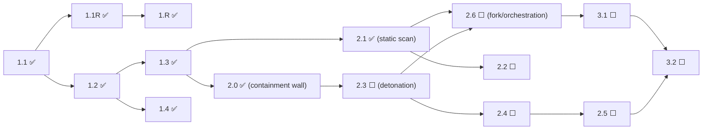

# Build Order - a dependency-graph view of what can be built when

> **This is a derived view, not the source of truth.** The one and only source of
> truth for story status is [`../RUNBOOK.md`](../RUNBOOK.md), now organized as a
> dependency-driven tiered build order. This page shows the **dependency structure**
> (the graph and the buildable-now / blocked-by relationships) drawn **from** that
> ledger to make the shape of the work easy to see. It does **not** own or maintain
> a copy of any story's status: for status, always read the RUNBOOK. This page must
> be **regenerated whenever dependencies change**, and it **never changes any
> status** on its own. If this page and the RUNBOOK ever disagree, the RUNBOOK wins.
>
> This page **supersedes** any earlier flat, linear "execution order" list. Story
> numbers (2.0, 2.1, 2.2, ...) are **not** a build order. The real order comes from
> the dependency graph below.
>
> How to read it, for a non-technical reader: a piece of work can only be built once
> **every** piece it depends on is finished (marked ✅). See
> [`governance/OPERATING_MODEL.md`](governance/OPERATING_MODEL.md) for how we then
> choose one at a time and prove it live.

## Status legend (for reference; status lives in the RUNBOOK)

`⬜ Not Started` · `🟡 In Progress` · `⛔ Blocked` · `✅ Done (validated)`

These markers are the legend the RUNBOOK uses. This page does not maintain a
per-story status list; any status glyph you see in the diagrams below is
**illustrative only**. For the authoritative status of any story, read the tiered
build order in [`../RUNBOOK.md`](../RUNBOOK.md).

## The dependency graph (Phase 1 and Phase 2)

This is the true shape. Note especially that **2.0 and 2.1 are independent
siblings** of 1.3 (neither depends on the other), and that **2.0's real downstream
is 2.3**, not 2.1. The glyphs in the diagrams are illustrative snapshots; status is
owned solely by the RUNBOOK.

```
Phase 1 (all ✅)
  1.1 ✅ ── 1.1R ✅ ── 1.R ✅
   └── 1.2 ✅ ─┬── 1.3 ✅
               └── 1.4 ✅

1.3 ✅ forks into two independent branches:

   branch A (the detonation line):
     2.0 ✅ ── 2.3 ⬜ ── 2.4 ⬜ ── 2.5 ⬜
     (containment    (detonation  (telemetry (sanitize
      wall)           chamber)     capture)   telemetry)

   branch B (the static line):
     2.1 ✅ ── 2.2 ⬜
     (static scan)   (compliance mapping)

   2.6 ⬜ joins BOTH branches (needs 2.1 AND 2.3):
     2.1 ✅ ──┐
              ├── 2.6 ⬜  (parallel orchestration / fork)
     2.3 ⬜ ──┘

Phase 3 hangs off 2.6 and 2.5:
     2.6 ⬜ ── 3.1 ⬜ ── 3.2 ⬜ (also needs 2.5) ── 3.3 ── 3.4 ── 3.5
     2.5 ⬜ ───────────────┘
```

The same shape as a mermaid diagram:



Reading the two branches: the **detonation line**
(`2.0 → 2.3 → 2.4 → 2.5`) is where the dangerous work happens, because 2.3 onward
actually runs untrusted code inside the containment that 2.0 builds. The **static
line** (`2.1 → 2.2`) only inspects artifacts and never runs them. The two lines are
"parallel" only in the sense that the graph does not force an order between them;
with a single developer we still do one at a time (see the note on "parallel" in
[`governance/OPERATING_MODEL.md`](governance/OPERATING_MODEL.md) §4).

## Buildable-now vs blocked-by (every story)

The direct dependencies below describe the graph's **structure**; they do not
change. **Status is not restated here** (that would be a second copy that could
drift): status lives only in the tiered build order in
[`../RUNBOOK.md`](../RUNBOOK.md). Read "Buildable when" as the rule for when a story
becomes eligible: a story is buildable once **all** of its direct dependencies are
done (✅) in the RUNBOOK. "On the critical path to detonation" flags the chain
leading to the dangerous Phase-2 detonation work (2.3 onward). For every story's
current status: **see RUNBOOK**.

| Story | Title | Direct dependencies | Buildable when | On critical path to detonation? |
|-------|-------|---------------------|----------------|---------------------------------|
| 1.1 | Intake gateway endpoint | none | foundation (no dependency) | (foundation) |
| 1.1R | Remediation: durable tracking record Forensic → Hub | 1.1 | 1.1 done in RUNBOOK | (foundation) |
| 1.R | Restore-point mechanism | 1.1R | 1.1R done in RUNBOOK | (foundation) |
| 1.2 | Preprocessor classifier | 1.1 | 1.1 done in RUNBOOK | (foundation) |
| 1.3 | Routing table → static & dynamic lanes | 1.2 | 1.2 done in RUNBOOK | (foundation) |
| 1.4 | Safe-reject path for unknown types | 1.2 | 1.2 done in RUNBOOK | no |
| 2.0 | AWS infra foundation (isolated VPC, IAM, launch template, SSM) | 1.3 | 1.3 done in RUNBOOK | **yes: the containment wall the detonation line sits on** |
| 2.1 | Static scanning stack | 1.3 | 1.3 done in RUNBOOK | no (static line) |
| 2.2 | Compliance-framework mapping + signature scans | 2.1 | 2.1 done in RUNBOOK | no (static line) |
| 2.3 | Detonation chamber (ephemeral EC2 + host-native SSM) | 2.0 | 2.0 done in RUNBOOK | **yes** |
| 2.4 | Behavioral telemetry capture | 2.3 | 2.3 done in RUNBOOK | **yes** |
| 2.5 | Telemetry sanitization pipeline | 2.4 | 2.4 done in RUNBOOK | **yes** |
| 2.6 | Parallel orchestration / fork of the two lanes | 2.1, 2.3 | 2.1 and 2.3 done in RUNBOOK | joins both lanes |
| 3.1 | Telemetry aggregation / normalization | 2.6 | 2.6 done in RUNBOOK | downstream |
| 3.2 | Nova Pro correlation engine | 3.1, 2.5 | 3.1 and 2.5 done in RUNBOOK | downstream |
| 3.3 | accuracy + gap_analysis synthesis | 3.2 | 3.2 done in RUNBOOK | downstream |
| 3.4 | Unified threat scoring + prioritized remediations | 3.3 | 3.3 done in RUNBOOK | downstream |
| 3.5 | Verdict derivation (PASS / FAIL / INCONCLUSIVE) | 3.4 | 3.4 done in RUNBOOK | downstream |
| 4.1 | Status-retrieval orchestrator | 3.5 | 3.5 done in RUNBOOK | downstream |
| 4.2 | Dashboard JSON payload | 4.1 | 4.1 done in RUNBOOK | downstream |
| 4.3 | Real-time dashboard | 4.2 | 4.2 done in RUNBOOK | downstream |
| 4.4 | Interactive accept/reject control (Hub) | 4.3, 4.7 | 4.3 and 4.7 done in RUNBOOK | downstream |
| 4.5 | Per-execution PDF report (tiered) | 4.1 | 4.1 done in RUNBOOK | downstream |
| 4.6 | ACCEPT → push artifact to Pipeline-Sandbox | 4.1 | 4.1 done in RUNBOOK | downstream |
| 4.7 | REJECT → destroy artifact + chamber / INCONCLUSIVE hold | 4.1 | 4.1 done in RUNBOOK | downstream |
| G-1 | Compliance back-mapping (RD-014) | none | no pipeline dependency | no (governance) |
| G-2 | Management-artifact integrity (RD-015) | none | no pipeline dependency | no (governance) |
| G-3 | Hard-pause enforcement (RD-023) | none | no pipeline dependency | no (governance) |

## What this view says right now

For the live status of any story, read [`../RUNBOOK.md`](../RUNBOOK.md); the notes
below describe the graph shape, not a maintained status copy.

- Story **2.0** — the load-bearing containment wall — was **validated live on
  2026-09-02 (Story A.2)**: all 7 DoD checks passed in Forensic, so 2.0 is now ✅ and
  its entry has been removed from the Validation Debt Register in
  [`../RUNBOOK.md`](../RUNBOOK.md) (the register is now **empty**; see the RUNBOOK for
  current status).
- The Advancement Gate blocks new feature work **only while the Validation Debt
  Register is non-empty**. With the register now empty, the gate is disarmed and
  feature work may resume; per the Floor & Harvest Plan (§4) the next moves are A.3
  (confirm 2.1) / A.4 (deployed-state restore capture). See
  [`governance/WORK_LOG.md`](governance/WORK_LOG.md).
- Story **2.1** and story **2.0** are **independent siblings** of 1.3: neither
  depends on the other. Finishing 2.1 did nothing to prove the containment wall
  that the detonation line depends on.

> Remember: this page is derived. When any dependency or status changes in
> [`../RUNBOOK.md`](../RUNBOOK.md), regenerate this page to match. It never sets or
> changes a status itself.
